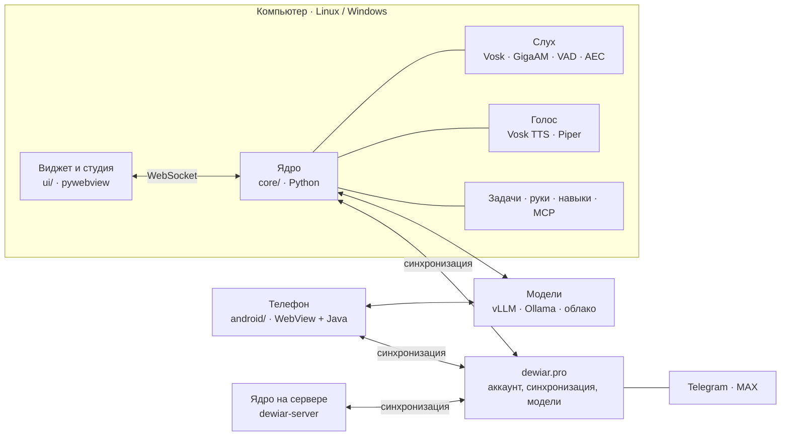

<div align="center">


### Голосовая помощница с командой персонажей — на компьютере, телефоне и вашем сервере

Зовёте по имени и разговариваете голосом. Перебиваете на полуслове, передаёте слово другому персонажу,
поручаете большую задачу — и она делается в фоне, пока вы заняты своим. Думает любой моделью: вашей
(vLLM, Ollama, llama.cpp, LM Studio) или облачной (Dewiar, OpenRouter, OpenAI, Claude).

<a href="https://github.com/dwr-git/dewiar-app/releases/latest/download/Dewiar-Setup-online.exe"></a>
<a href="https://github.com/dwr-git/dewiar-app/releases/latest/download/dewiar-assistant_all.deb"></a>
<a href="https://dewiar.pro/dwrapp/Dewiar.apk"></a>
<a href="https://dewiar.pro/dwrapp/web/"></a>
<a href="https://dewiar.pro/dwrapp/download.php"></a>

[](https://github.com/dwr-git/dewiar-app/releases/latest)
[](https://github.com/dwr-git/dewiar-app/stargazers)
[](https://github.com/dwr-git/dewiar-app/actions/workflows/checks.yml)

[Сайт](https://dewiar.pro) · [Руководство](https://dewiar.pro/dwrapp/guide.php) · [Свой сервер](docs/self-hosting.md) ·
[История версий](CHANGELOG.md) · [Для разработчика](CONTRIBUTING.md)

</div>

> **In English.** Dewiar is a voice assistant with a team of AI characters for Windows, Ubuntu and Android. Call it
> by name and talk: it sets reminders (with screenshots attached), calls and messages your people, builds walking
> routes, reads receipts from a photo, remembers what you told it — and how that changed, runs big tasks (even code
> fixes against tests) in the background. Risky actions need your "yes". Any model works: your own (vLLM, Ollama,
> llama.cpp, LM Studio) or a cloud one. Every release passes a 50+ scenario exam judged by a separate model.
> The interface speaks Russian for now. If you like the idea, a ⭐ helps the project grow.

## Что умеет

**Разговор, а не команды.** Слышит имя офлайн и мгновенно — даже то, которое вы придумали сами. Начали говорить
поверх ответа — затихает и слушает; «стоп», «хватит» — замолкает. Лира с живым лицом ведёт ваш день, Патрик помогает
обдумать решения; ещё дюжина персонажей добавляется одной кнопкой, и Лира сама передаёт им вопрос по их части.
Свой персонаж — с любым именем, голосом и вашим фото.

<div align="center">

</div>

**Руки и глаза.** Открывает сайты и программы, ищет в интернете, ставит напоминания и будильники, управляет
музыкой, телевизором и умным домом, пишет заметки и ведёт деньги, читает почту и календарь, видит экран и камеру.
На телефоне — работает в других приложениях: «напиши маме в Telegram, что задержусь».

**Большие задачи в фоне.** «Возьми задачу: разберись, почему падают тесты, и почини» — план, журнал каждого шага,
вопросы голосом, итог. Независимые куски делают помощники одновременно; код правится в отдельной рабочей копии,
работа не сдаётся, пока тесты падают, а вы принимаете изменения по diff. До 1200 шагов без «продолжи».

**Память и знания.** Помнит, что вы рассказали о себе, — и как это менялось («бюджет 65 тысяч, раньше 50 → 70»);
«в среду в 15:00 встреча» попадёт в календарь с точной датой. Считает калькулятором, а не в уме. Ведёт дневник,
отвечает по вашим документам (PDF, Word, Markdown) и заметкам Obsidian — офлайн, с поиском по формам слов.

**Везде одно.** Компьютер, телефон и сервер синхронизируются через аккаунт dewiar.pro; Telegram и MAX — ещё один
способ поговорить. Компьютер выключен — отвечает телефон, а большие задачи делает облако Dewiar.

**Ваше остаётся вашим.** Работает с моделью на вашем сервере без облака. Опасные действия — только после «да»,
пароли — в сейфе, отчёт разработчику — без ключей и паролей.

<div align="center">
&nbsp;&nbsp;

</div>


### Близкие

Переписка между помощниками разных людей: «Лира, напиши маме, что я задержусь» — у мамы её помощница покажет
сообщение и прочитает вслух. Файлы, аудио- и видеозвонки, приглашение печатью Dewiar (строгий чёрный Aztec — его
читает сканер Dewiar и Google Lens), обычным QR или ссылкой. Сообщения и файлы шифруются на устройствах
(X25519 + HMAC-SHA256, `core/closecrypto.py` и `ui/assets/closecrypto.js`), звонки идут напрямую между устройствами
(WebRTC).

<div align="center">
&nbsp;&nbsp;

</div>

### Сканер, часы и ваши данные

**Сканер кодов на телефоне** — «отсканируй код»: QR, Aztec, штрихкоды и Data Matrix товаров. Ссылку предложит
открыть, а по коду товара или «Честного знака» Лира сама найдёт, что это за товар.
**Напоминания на умных часах** — с кнопками «Понял» и «Через 10 минут» прямо на часах.
**«Ваши данные»** — коротко и честно, что где хранится и куда уходит: в студии, на телефоне, на сайте — и Лира
сама спокойно ответит на «как защищены мои данные?».

Всё по шагам, с примерами фраз и поиском «своими словами» — в
**[руководстве на dewiar.pro](https://dewiar.pro/dwrapp/guide.php)**. Лира знает его сама: спросите «как добавить
маму в близкие?» или «где поменять фон?».

### Стили

Виджет, студия и телефон — в любом стиле: фирменный, глассморфизм, неоморфизм, «Вижн», белоснежный и другие.
Фон и анимация голоса выбираются отдельно — студия → «Оформление», на телефоне — «Ещё» → «Оформление».

<p align="center">

</p>

## Что нужно и что бесплатно

- **Программа — бесплатно**, целиком: без подписок и рекламы.
- **Кто думает — выбираете вы.** Облако Dewiar (кнопка «Подключить бесплатно»; расход — в ИИ-талерах, на старте они
  уже есть), ваш компьютер (Ollama или LM Studio — бесплатно и без интернета, нужна видеокарта) или ключ сервиса
  (OpenAI, DeepSeek, OpenRouter и другие — платите им по их тарифу).
- **Компьютер.** С облаком или ключом — Windows 10–11 или Linux, память от 8 ГБ (удобнее 16); слабому компьютеру
  Dewiar сам включит лёгкий режим. Для своей модели — видеокарта от 8 ГБ для лёгких моделей, для моделей уровня
  Qwen 27B — от 24 ГБ или две по 16.
- **Телефон** — Android 7 и новее. **iPhone, iPad и Mac** — [в браузере](https://dewiar.pro/dwrapp/web/), без установки;
  на iPhone: Safari → «Поделиться» → «На экран Домой».

## Скачать — всегда последняя версия

Проще всего — страница **[dewiar.pro/dwrapp/download.php](https://dewiar.pro/dwrapp/download.php)**: сама узнаёт ваше
устройство и даёт свежую версию, для телефона на компьютере — QR-код.

Все файлы последнего выпуска — на странице [Releases → latest](https://github.com/dwr-git/dewiar-app/releases/latest). Прямые
ссылки ниже не меняются и всегда ведут на самое свежее:

| Где | Файл |
|---|---|
| **Windows 10 / 11** | [Dewiar-Setup-online.exe](https://github.com/dwr-git/dewiar-app/releases/latest/download/Dewiar-Setup-online.exe) |
| **Ubuntu 22.04 / 24.04** | [dewiar-assistant_all.deb](https://github.com/dwr-git/dewiar-app/releases/latest/download/dewiar-assistant_all.deb) |
| **Android** | [Dewiar.apk](https://dewiar.pro/dwrapp/Dewiar.apk) · с управлением приложениями — [Dewiar-hands.apk](https://dewiar.pro/dwrapp/Dewiar-hands.apk) — с сайта, подписаны ключом выпуска |

## Установка

| Где | Как |
|---|---|
| **Ubuntu 22.04 / 24.04** | `sudo apt install ./dewiar-assistant_X.Y.Z_all.deb` — дальше обновляется сам |
| **Другой Linux** (Arch, Manjaro, Omarchy, Fedora, openSUSE, ALT, Void, Debian…) | `curl -fsSL https://raw.githubusercontent.com/dwr-git/dewiar-app/main/install.sh \| bash` — поставит библиотеки окна и звука вашим менеджером пакетов и сам Dewiar; удалить — `bash install.sh --remove` |
| **Windows 10 / 11** | `Dewiar-Setup-X.Y.Z-online.exe` (< 30 МБ) или полный `Dewiar-Setup-X.Y.Z.exe`; права администратора не нужны |
| **Android** | [`Dewiar.apk`](https://dewiar.pro/dwrapp/Dewiar.apk) или QR-код в студии → «Подключение» → «Dewiar на телефоне» |
| **Сервер, круглосуточно** | тот же `.deb`, затем `sudo dewiar-server setup` — [подробнее](docs/self-hosting.md#ассистент-круглосуточно-dewiar-server) |

Первый запуск откроет студию на разделе «Мозг»: выберите, где думать ассистенту, — мастер найдёт сервер в сети,
модель на этом компьютере или подключит облако по ключу. Дальше — [первые пять минут](https://dewiar.pro/dwrapp/guide.php#first-steps).

## Как устроено

<div align="center">

</div>

<details>
<summary><b>Для разработчика: из чего состоит программа</b></summary>
<br>



| Папка | Что внутри |
|---|---|
| `core/` | Ядро: слух, голос, разговор и персонажи, модели, руки, задачи, память, синхронизация, сейф, обновления |
| `ui/` | Окна компьютера: виджет `hud.html`, студия `settings.html` + `studio/*.js`, обёртка `app.py` |
| `android/` | Приложение Android: интерфейс `assets/www/app.js`, мост и службы на Java; сборка без Gradle |
| `server/` | Серверы речи и синтеза для своей машины с видеокартой (`install-server.sh`) |
| `packaging/`, `tools/` | Пакет `.deb`, установщики Windows, выпуск версии одной командой |
| `data/` | Облики персонажей, встроенные навыки, модель VAD, радио |
| `tests/` | 273 наборов проверок: настоящее ядро, окна в Chromium, телефон на подменённом мосте |

</details>

## Разработка

```bash
pip install -r requirements.txt -r requirements-extra.txt
python3 core/main.py            # ядро (слух, голос, разговор);  окна — python3 ui/app.py
tests/run_quick.sh              # быстрые проверки, ~2 минуты — их же гоняет GitHub
tests/run_all.sh                # все: нужны Playwright с Chromium, espeak-ng, ffmpeg
tools/build_deb.sh dist         # пакет Linux;  tools/build_win.sh — Windows;  android/tools/build_apk.sh — телефон
```

Как сообщить об ошибке, предложить правку и правила кода — в [CONTRIBUTING.md](CONTRIBUTING.md). Нашли уязвимость — [SECURITY.md](SECURITY.md).

## Поддержать

Понравилось — поставьте ⭐ репозиторию: так Dewiar находят другие. Нашли ошибку или есть идея —
[откройте issue](https://github.com/dwr-git/dewiar-app/issues/new/choose), отвечаем быстро.

## Авторы

Dewiar придумал и ведёт [dewiar.pro](https://dewiar.pro). Код пишется вместе с Claude (Anthropic) — соавтором
проекта: его записи в истории помечены строкой `Co-Authored-By: Claude`.

## Лицензия

© 2026 Dewiar. Все права защищены — см. [LICENSE](LICENSE). Сторонние библиотеки, модели и шрифты —
на условиях своих лицензий.
